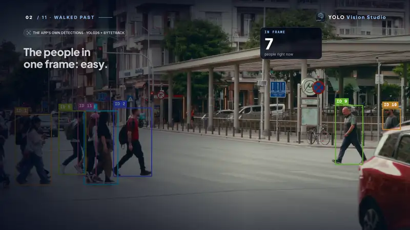
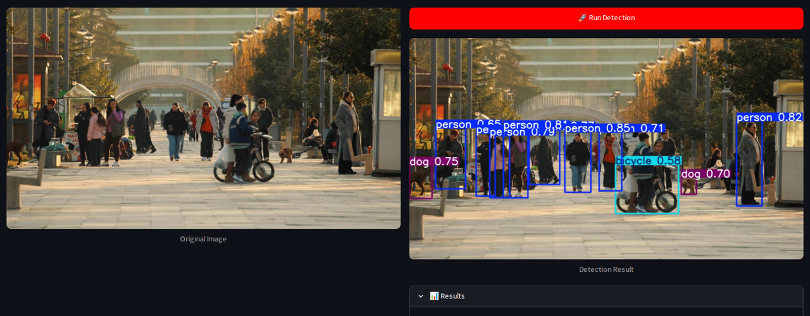
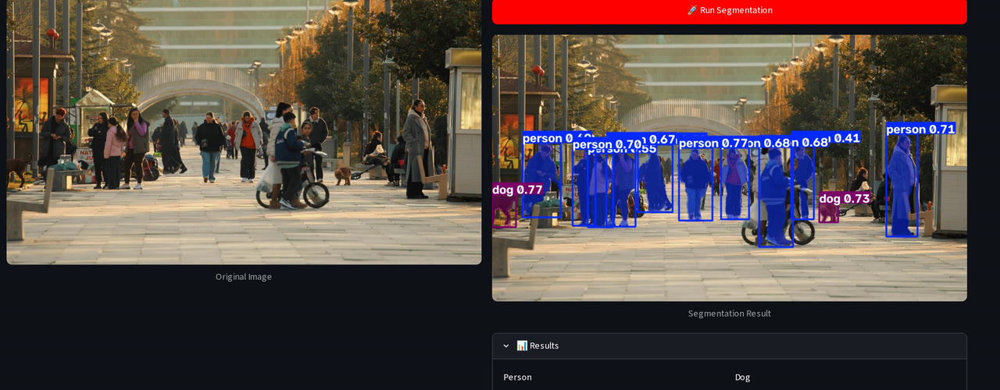
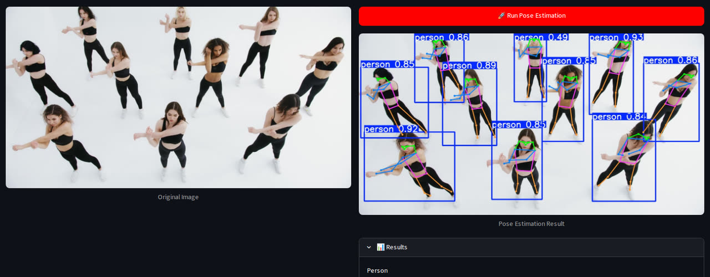
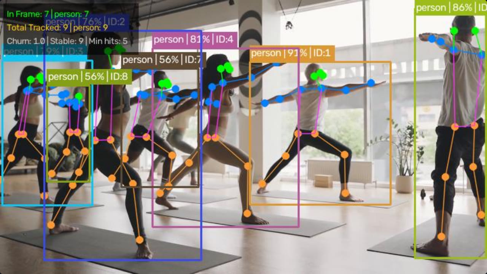
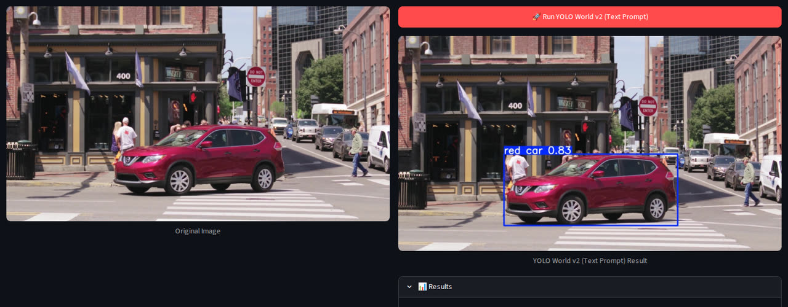
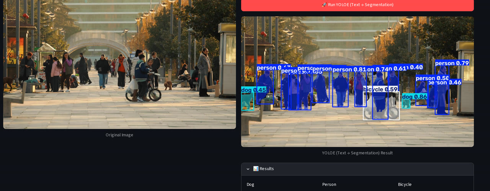
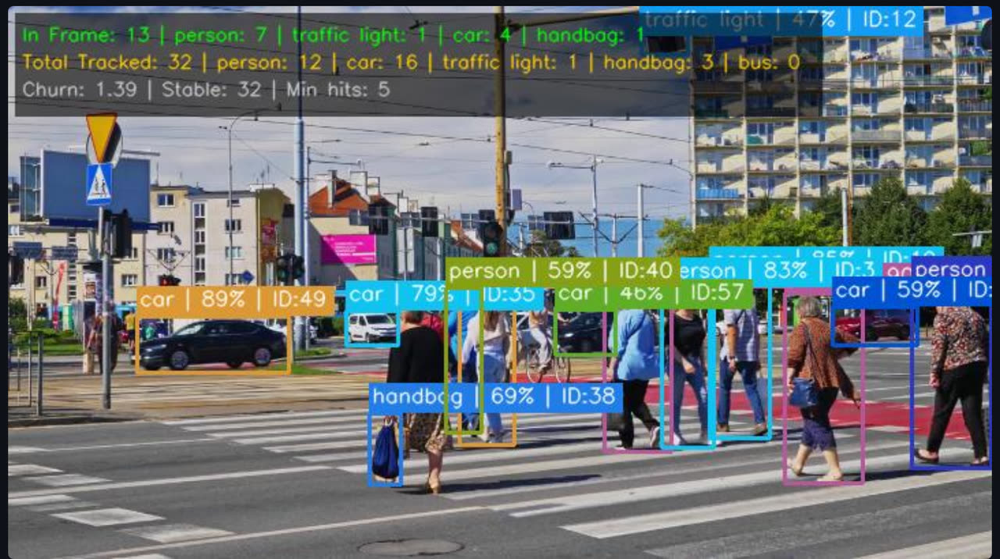
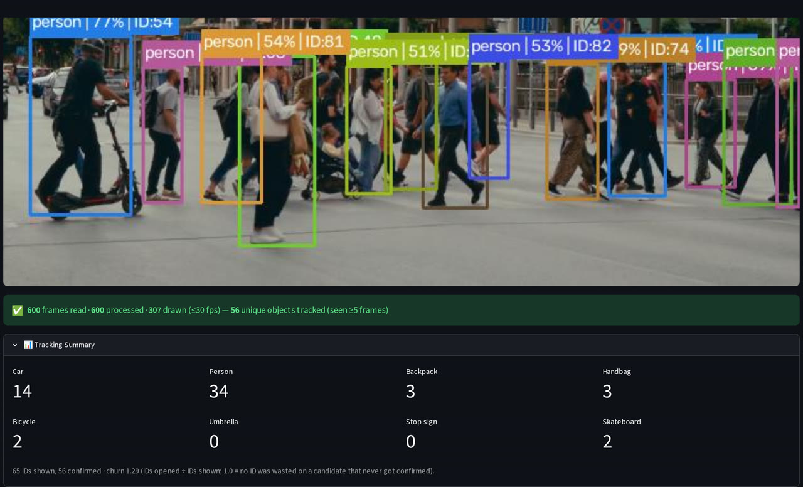
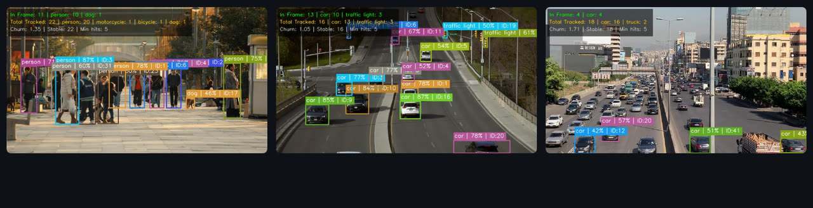

<div align="center">

# 🔬 YOLO Vision Studio

**Detect · Segment · Read poses · Find what you type · Track and count in video**<br>
A free, open-source Streamlit app built on Ultralytics YOLO26, YOLOE, YOLO World v2 and RT-DETR.

[](https://github.com/aparsoft/yolo-streamlit-detection-tracking/stargazers)
[](https://github.com/aparsoft/yolo-streamlit-detection-tracking/releases/latest)
[](https://python.org)
[](https://ultralytics.com)
[](LICENSE)

[Watch the film](https://github.com/aparsoft/yolo-streamlit-detection-tracking/releases/download/v2.1.0/yolo-vision-studio-film-16x9.mp4) · [45-second cut](https://github.com/aparsoft/yolo-streamlit-detection-tracking/releases/download/v2.1.0/yolo-vision-studio-45s-9x16.mp4) · [Quick start](#-quick-start) · [Report a bug](https://github.com/aparsoft/yolo-streamlit-detection-tracking/issues)



</div>

---

## Why this app

Point a camera at a street and ask how many people walked past. Counting the people **in one frame** is easy.
Knowing how many **different** people walked past is the hard part: people overlap, cross and walk out of view, and a
careless tracker counts the same person three times.

YOLO Vision Studio shows both numbers on every frame, and is honest about them. The overlay has three lines:

- **In Frame** (green): what the detector sees right now, per class.
- **Total Tracked** (yellow; *Total Unique Objects* in the sidebar): different objects so far. An object counts only
  after it has been seen in **5 processed frames**, so a one-frame false detection never inflates the total.
- **Churn** (grey): track IDs the tracker opened ÷ IDs it actually showed. The tracker opens an ID for every candidate
  track, and a candidate that disappears before it is confirmed is never drawn. 1.0 means no ID was wasted; a high
  value means many short-lived candidates (flicker, occlusion, borderline detections).

## What it does

| | |
|:--|:--|
| <br>**Detect** the 80 COCO object types (YOLO26 nano → xlarge, or RT-DETR) | <br>**Segment**: a pixel mask for every object |
| <br>**Pose**: 17 body keypoints and the skeleton | <br>**Every task works on video**, here pose with tracked IDs |
| <br>**Type what you're looking for** (YOLO World v2): `red car` finds only the red one | <br>**YOLOE**: type category names, get boxes **and** masks |
| <br>**Four trackers** and optional appearance ReID; every box reads `class \| conf \| ID` | <br>**Tracking Summary**: confirmed objects per class, IDs and churn |



**Several stored videos side by side**, each with its own model and tracker, so IDs and counts never mix.

### Feature overview

| Area | What you get |
|:--|:--|
| **Tasks** | Detection, Segmentation, Pose Estimation, YOLO World v2 (text prompt), YOLOE (text → masks). All of them work on images and on video |
| **Models** | YOLO26 n / s / m / l / x for detection, segmentation and pose; RT-DETR L / X (transformer) for detection; YOLO World v2 s / m / l / x; YOLOE-26 n / s / m / l / x. Weights download on first use |
| **Images** | Upload JPG, PNG, BMP or WEBP, or run on the default image. Phone photos are rotated by their EXIF tag. Results: the annotated image, a count and average confidence per class, every detection's confidence, and the pose or mask count |
| **Video sources** | Stored files (several at once), your **webcam** in the browser (streamlit-webrtc), **RTSP** camera streams, **YouTube** URLs (yt-dlp) |
| **Tracking** | ByteTrack (default), BoT-SORT, Deep OC-SORT, TrackTrack. Each box carries its ID, in a colour that belongs to that ID |
| **Appearance ReID** | For BoT-SORT, Deep OC-SORT and TrackTrack: choose an encoder (`yolo26n-cls`, `yolo26s-reid.onnx` or the detector's own features) and tune three gates: proximity (IoU), appearance similarity and lost-track memory |
| **Speed controls** | 🎯 **Limit to classes** (detection, segmentation, pose), ⏩ **Skip frames** 1–8×, a confidence slider. Every processed frame is detected and counted; only the display is capped at 30 fps, to keep the browser smooth |
| **Live metrics** | Frame, FPS, in-frame counts, confirmed totals per class and churn in the sidebar, refreshed 5× a second. ⏹ **Stop** ends a run and keeps the counts so far |
| **Several users** | Tracking runs on a model owned by each browser session, so two visitors never share a tracker. Shared cached models are locked during inference |

**YOLO World prompts:** one object with one attribute works best (`red car`, `dog`, `wooden chair`). Descriptions of
people (`person in black`) score low; if a prompt finds nothing, lower the confidence.
**YOLOE prompts:** category names only (`person, car, laptop`), not descriptions.

**Privacy:** appearance ReID compares how objects look *within one video* to keep an ID through a crossing. The app
never knows who anyone is; there is no face recognition.

---

## 🚀 Quick start

**With [uv](https://docs.astral.sh/uv/) (recommended):** installs the exact versions in `uv.lock` on Linux, macOS and
Windows.

```bash
git clone https://github.com/aparsoft/yolo-streamlit-detection-tracking.git
cd yolo-streamlit-detection-tracking
uv sync                                     # creates .venv with the locked versions
uv run python scripts/get_sample_videos.py  # optional: the 8 other sample clips (~34 MB)
uv run streamlit run app.py                 # opens http://localhost:8501
```

**With pip:**

```bash
git clone https://github.com/aparsoft/yolo-streamlit-detection-tracking.git
cd yolo-streamlit-detection-tracking
python -m venv .venv
source .venv/bin/activate                   # Windows: .venv\Scripts\activate
pip install -r requirements.txt             # or requirements-lock.txt for the exact locked versions
python scripts/get_sample_videos.py         # optional
streamlit run app.py
```

**Requirements and first run**

- **Python 3.10+** (tested on 3.11 and 3.12). Runs on CPU; an NVIDIA GPU makes video much faster.
- **GPU on Linux:** PyTorch from PyPI already includes CUDA, with uv and with pip.
- **GPU on Windows:** PyPI's PyTorch is CPU-only there. With pip, install a CUDA build from
  [pytorch.org](https://pytorch.org/get-started/locally/) first, then `requirements.txt`. With uv, `uv sync` installs the
  locked PyPI build, so install the CUDA build into `.venv` afterwards (`uv pip install torch torchvision --index-url …`)
  and start the app with `uv run --no-sync streamlit run app.py`.
- **Model weights download automatically** on first use, into `weights/`. YOLO World also fetches its CLIP text encoder
  (~340 MB) and YOLOE its MobileCLIP encoder (~245 MB) the first time you use them.
- `uv sync` also installs Jupyter support for the [playground notebook](docs/yolo26_playground.ipynb).
  `uv sync --group rfdetr` adds RF-DETR and `supervision` for your own experiments; the app does not use them.

### Sample videos

One clip ships in git (`videos/pedestrians_summer_street.mp4`), so the app works straight after a clone. The other
eight live on the [sample-videos release](https://github.com/aparsoft/yolo-streamlit-detection-tracking/releases/tag/sample-videos)
to keep the repo small; `scripts/get_sample_videos.py` downloads them and checks each one against its SHA-256, so every
machine runs the same clips (`--force` downloads them again). They are [Pexels](https://www.pexels.com/license/) clips,
chosen by running this app's own detector and tracker over 731 candidates; creators are credited in
[`videos/ATTRIBUTION.md`](videos/ATTRIBUTION.md).

| Clip | Good for |
|:--|:--|
| `pedestrians_summer_street` (in git, the default) | People counting and tracking |
| `crosswalk_red_car` · `street_person_in_red` | YOLO World prompts |
| `street_dogs_bikes` | Mixed classes: people, dogs, bicycles |
| `highway_bridge_traffic` · `city_traffic_dense` | Vehicle counting, many IDs at once |
| `yoga_warrior_pose` · `stretching_from_above` | Pose estimation |
| `busy_intersection` | Paths crossing: ReID trackers, multi-video |

**Your own videos:** drop `.mp4`, `.avi`, `.mkv`, `.mov`, `.wmv` or `.webm` files into `videos/`. They appear in the
picker on the next rerun. Extensions are matched in lower case, so rename `CLIP.MP4` to `CLIP.mp4`.

---

## 📖 Using it

**Sidebar, top to bottom:** Inference Mode (📷 image / 🎬 video) → Task → 🧠 Model (nano is fastest, xlarge most
accurate) → Model Confidence (10–100 %, default 40 %).

### Images

1. For YOLO World or YOLOE, type the prompt first (comma-separated).
2. Upload an image, or keep the default one.
3. Press **🚀 Run \<task\>**. The result stays on screen until you change the image, task, model, prompt or confidence.

### Video

1. **📹 Video Source:** Stored Video, Webcam, RTSP Stream or YouTube.
2. **Tracking** is on by default. Pick a tracker; for BoT-SORT, Deep OC-SORT and TrackTrack you can switch on
   **🧬 Appearance ReID**, choose its encoder and tune its gates. ReID costs roughly two-thirds of the FPS.
3. Optional: **🎯 Limit to classes**, **⏩ Skip frames**. For YOLO World / YOLOE, type the prompts in the main panel.
4. Start it:

| Source | How to start | What you get at the end |
|:--|:--|:--|
| Stored Video, one clip | **🚀 Detect Video Objects** | The last frame, a run summary and the 📊 Tracking Summary |
| Stored Video, several clips | Select them all, then **🚀 Detect Video Objects** | A 3-per-row grid; one result line per video (IDs are per video and never summed) |
| RTSP Stream | Paste the URL, **🚀 Start RTSP Stream** | As for one stored clip |
| YouTube | Paste the URL, **🚀 Detect YouTube Video** | As for one stored clip |
| Webcam | **START** in the player, allow the camera | Live annotated video; stop it with the player's **STOP** |

**⏹ Stop** (sidebar) ends a stored, RTSP or YouTube run early; the frame on screen and the counts so far stay. With
**Skip frames** above 1 and tracking on, objects move further between updates, which is where ReID helps most.

---

## ⚙️ Configuration

Every default lives in `config.py`:

| Setting | Default | What it does |
|:--|:--|:--|
| `DEFAULT_CONFIDENCE` | `0.40` | Starting value of the confidence slider |
| `MIN_TRACK_HITS` | `5` | Processed frames before a track counts |
| `TRACKERS_LIST` | ByteTrack, BoT-SORT, Deep OC-SORT, TrackTrack | Trackers in the sidebar. `TRACKER_OCSORT` and `TRACKER_FASTTRACK` are already defined; add them to the list to offer them |
| `GMC_METHOD` | `"none"` | Camera-motion compensation for the non-ByteTrack trackers; use `"sparseOptFlow"` for a moving camera |
| `REID_ENCODER_CHOICES`, `REID_PROXIMITY_THRESH`, `REID_APPEARANCE_THRESH`, `REID_TRACK_BUFFER` | see file | ReID encoders and the starting values of its three sliders |
| `VIDEO_DISPLAY_WIDTH` | `720` | A ceiling on the processed and streamed width; frames are never upscaled |
| `VIDEO_DISPLAY_FPS` | `30.0` | Frames painted per second (every frame is still inferred) |
| `VIDEO_JPEG_QUALITY`, `METRICS_REFRESH_HZ` | `75`, `5.0` | Streaming quality and the sidebar refresh rate |
| `MIN_SKIP_FRAMES`, `MAX_SKIP_FRAMES` | `1`, `8` | Range of the skip-frames slider |
| `DEFAULT_IMAGE`, `DEFAULT_VIDEO` | `office_4.jpg`, `pedestrians_summer_street` | What the image page and the video picker start with |
| `DEFAULT_WORLD_CLASSES`, `DEFAULT_YOLOE_CLASSES` | `person, car, dog, …` | Starting prompts |

**Your own model:** put the `.pt` file in `weights/` and add it to the task's catalog in `config.py`
(for example `DETECTION_MODELS["My model"] = "my_model.pt"`). It then appears in the 🧠 Model selector.

## 🧠 How it works

- **One per-frame path** for every source (`video_service._process_frame`): resize to at most 720 px, track or predict,
  count, draw the boxes and IDs, draw the overlay.
- **Isolated tracker state:** tracking uses a session-owned model, multi-video gives each clip a fresh model, and each
  model keeps its own track-ID counter, so concurrent runs never interleave IDs. Trackers reset at the end of every
  run, so the same video with the same settings gives the same count.
- **Smooth playback:** frames are painted at most 30 times a second, sidebar metrics 5 times a second, and replaced
  frames are freed during the run instead of at its end.

The measurements behind these choices are in [`docs/single_video_performance.md`](docs/single_video_performance.md)
and [`docs/multi_video_performance.md`](docs/multi_video_performance.md).

## 📚 Learn with it

- **[`docs/yolo26_playground.ipynb`](docs/yolo26_playground.ipynb):** a runnable tour of YOLO26: the `Results` object,
  confidence and model size, RT-DETR, segmentation, pose, YOLO World vs YOLOE, tracking and local vs global counting,
  video sources, performance tuning (`imgsz`, skip frames, half precision), the architecture, export, oriented boxes
  (OBB) and the CLI. `docs/obb_images.py` fetches the aerial image its OBB section uses.
- **[`docs/yolo26_docs.md`](docs/yolo26_docs.md):** notes on what YOLO26 changed (NMS-free heads, no DFL, ProgLoss, STAL, MuSGD).
- **`docs/test.py`:** the smallest possible YOLO26 script, as a starting point.

## 🗂️ Project structure

```
yolo-streamlit-detection-tracking/
├── app.py                    # page setup, sidebar, routing
├── config.py                 # models, paths, defaults
├── model_loader.py           # cached, per-session and per-video models; device placement
├── image_service.py          # image tasks: upload → run → results
├── video_service.py          # sources, tracking, counting, overlay, live metrics
├── scripts/
│   └── get_sample_videos.py  # downloads and verifies the sample clips
├── docs/                     # playground notebook, YOLO26 notes, performance write-ups
├── assets/readme/            # README media
├── images/                   # sample images (credits in images/ATTRIBUTION.md)
├── videos/                   # your clips + the default one (credits in videos/ATTRIBUTION.md)
├── weights/                  # model weights, downloaded on first use
├── pyproject.toml  uv.lock                              # uv
└── requirements.txt  requirements-lock.txt  packages.txt  # pip, Streamlit Cloud
```

## ☁️ Deploy to Streamlit Cloud

Connect the repo at [share.streamlit.io](https://share.streamlit.io) with `app.py` as the main file; `requirements.txt`
and `packages.txt` handle the dependencies. Things to know:

- There is no GPU, so video is slower than on a local NVIDIA card.
- Only the default clip is in git. Add your own clips to `videos/` in your fork, or use RTSP / YouTube.
- The webcam connects through WebRTC. On some networks it needs a TURN server, which the app does not configure.

---

## 🤝 Contributing

Issues and pull requests are welcome: fork, branch, commit, open a PR. Good first ideas:

- [ ] Export detections and tracks to CSV / JSON
- [ ] Region-of-interest (line or zone) counting
- [ ] An `imgsz` control in the sidebar (accuracy vs speed)
- [ ] A model comparison page
- [ ] A multi-camera RTSP dashboard

## 📄 License

The app's code is [Apache-2.0](LICENSE). The models come from [Ultralytics](https://github.com/ultralytics/ultralytics)
under **AGPL-3.0** (closed-source commercial use needs their Enterprise licence). The sample footage is from Pexels
creators ([credits](videos/ATTRIBUTION.md)).

## 🙏 Acknowledgements

- [Ultralytics](https://github.com/ultralytics/ultralytics) for YOLO26, YOLOE, YOLO World and RT-DETR
- [Streamlit](https://github.com/streamlit/streamlit) and [streamlit-webrtc](https://github.com/whitphx/streamlit-webrtc)
- The Pexels creators whose clips make the demos, and all 400+ stargazers ⭐

<div align="center">

Made by [Aparsoft](https://aparsoft.com/) · Need vision AI on your own cameras? **contact@aparsoft.com**

</div>
